# Following the Compute Money

On-chain forensics of GPU-backed credit and decentralized compute markets.

Some stablecoin protocols take deposits and lend them to companies that run GPU clusters. The GPUs, the borrowers and the loan contracts are off-chain, but every deposit, loan, repayment, fee, redemption and bridge transfer is logged on a public chain. This repo rebuilds one of these protocols, USD.AI on Arbitrum, from those logs, checks the result against the vault's own accounting, and compares it with the compute that people actually buy and pay for on-chain through Akash and Livepeer.

- Paper, published version (SSRN, 15 pages): [`Following_the_Compute_Money.pdf`](Following_the_Compute_Money.pdf)
- LaTeX source and a build from it: [`paper/`](paper/) (`paper/main.pdf` is what `reproduce.py --compile` produces; its text matches the published PDF, with two reference dates corrected)
- Every chart on one page that works offline: [`visuals/index.html`](visuals/index.html)

Study window: <!--n:StudyStart-->2025-05-12<!--/n--> (vault deployment) to <!--n:StudyEnd-->2026-10-22<!--/n-->. Chain data comes from the Covalent GoldRush API unless a section says otherwise.

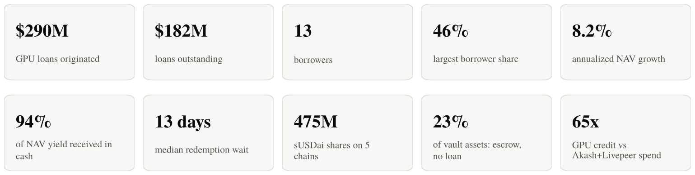

## What we found

### 1. The loan book

<!--n:NLoans-->39<!--/n--> loans went to <!--n:NBorrowers-->13<!--/n--> borrower addresses: <!--n:Originated-->$290.1M<!--/n--> originated, <!--n:Outstanding-->$182.2M<!--/n--> still outstanding, at rates from <!--n:RateMin-->7.0%<!--/n--> to <!--n:RateMax-->15.0%<!--/n-->. No loan has a recorded breach or liquidation so far, which says something about a young loan book, not about full-cycle performance. <!--n:NMigrated-->17<!--/n--> loans were moved from the V1 to the V2 loan router and <!--n:NRefinanced-->4<!--/n--> were refinanced into new terms; a loan that changed hash is counted once.

The largest borrower address received <!--n:TopOneShare-->45.6%<!--/n--> of all lending and the top three received <!--n:TopThreeShare-->76.8%<!--/n-->. The HHI is <!--n:HHIOrig-->0.273<!--/n--> on originations and <!--n:HHIOut-->0.197<!--/n--> on outstanding principal; that is a portfolio concentration measure, and it says nothing about whether the 13 addresses are 13 independent borrowers.

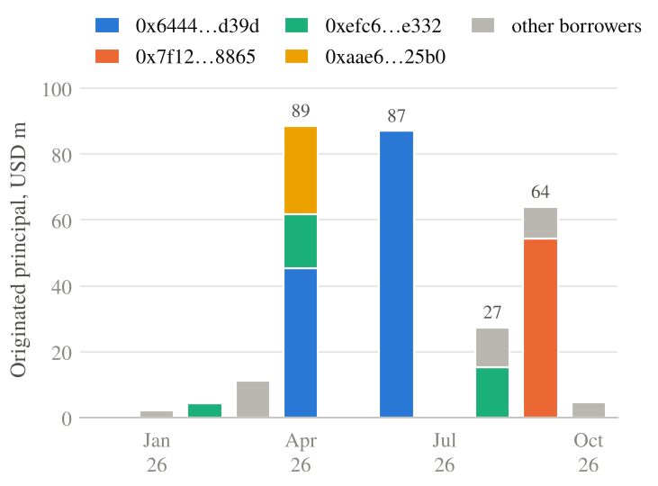

### 1a. What the collateral is

I had written that the collateral was opaque. It isn't. Every loan is secured by a token from the protocol's "USD.AI Tokenized Hardware" contract, and each token's on-chain `tokenURI` points to a record the protocol publishes: server model, unit count, stated collateral value, useful life, depreciation start and, for the early loans, serial numbers. The host served <!--n:CollRecords-->87<!--/n--> records, including two for token IDs that are not minted; those two are left out of every total below.

The active book is secured by <!--n:CollUnits-->630<!--/n--> units, about <!--n:CollGPUs-->4,560<!--/n--> GPUs counting eight per B200, B300 or H200 server, with a stated value of <!--n:CollValue-->$272.8M<!--/n--> against <!--n:Outstanding-->$182.2M<!--/n--> outstanding. That is a <!--n:BookLTV-->66.8%<!--/n--> loan-to-value, ranging from <!--n:LTVMin-->43%<!--/n--> to <!--n:LTVMax-->80%<!--/n--> by loan. Mixed and workstation rows are not in the GPU count. Every record assumes a three-year useful life with depreciation starting on borrow. The records are the protocol's own statements, hosted off-chain, so they are what USD.AI says the collateral is, not an appraisal.

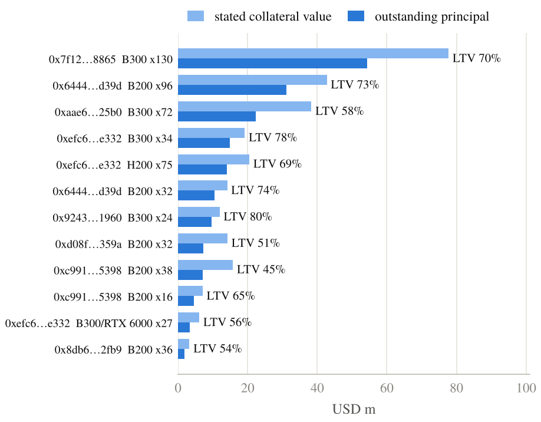

One token matters for the escrow finding: 288 B300 servers with a stated value of $140.2M secured the largest borrower's $87.1M loan until that loan was repaid in full on October 1, eight days after the $128.9M escrow deposits. The token now sits unpledged in the borrower's reserve account. The metadata host also serves two records for token IDs that have not been minted, both GB200 NVL72 racks with $161.1M of stated value between them; they are not in any collateral total. A refinancing in progress is one possible reading of this sequence, but no matching new loan or legal commitment can be verified from the chain, and an unminted record is not proof of pledged collateral.

### 1b. Maturities and payment status

The <!--n:NActive-->21<!--/n--> active loans run <!--n:TermMin-->2.1<!--/n--> to <!--n:TermMax-->3.0<!--/n--> years. Weighted by outstanding principal, <!--n:YearsToMaturity-->2.6<!--/n--> years remain: <!--n:MatTwentyEight-->$13.3M<!--/n--> matures in 2028 and <!--n:MatTwentyNine-->$168.9M<!--/n--> in 2029. Holders, meanwhile, exit through a queue with a <!--n:WaitMedian-->13.0<!--/n-->-day median wait for completed requests. No loan is flagged late by the event test; the longest gap since a payment is <!--n:MaxDaysSincePayment-->25<!--/n--> days, inside the monthly schedule. The oldest active loan is under a year old, so this is a young, right-censored book.

### 2. Where the yield comes from

sUSDai's NAV grew <!--n:AnnTotal-->8.17%<!--/n--> a year, and <!--n:CashCoverage-->93.7%<!--/n--> of the yield credited to holders has arrived as cash. Borrower interest was only <!--n:CashInterest-->$6.65M<!--/n--> of that cash. Base yield from stablecoin issuers was <!--n:CashBase-->$15.08M<!--/n-->: <!--n:CashBasePYUSD-->$6.36M<!--/n--> of PYUSD incentives harvested from the reserve and <!--n:CashBaseWM-->$8.72M<!--/n--> minted from M^0's yield-bearing wM. Each source on its own is smaller than borrower interest, but together they are more than twice as large. Over this window, holders received more cash from stablecoin issuers than from GPU borrowers. The one-off $7.82M wM deposit on 2026-02-02 drives much of that, so the mix is a historical fact, not a forecast.

The layers, cumulative, with the share of credited yield each one brings coverage to:

| Cash layer | This layer | Coverage |
|---|---|---|
| Borrower interest and fees | $6.95M | <!--n:KappaBorrowers-->28.4%<!--/n--> |
| Escrow interest on pre-funded loans | <!--n:EscrowRegular-->$539k<!--/n--> | <!--n:KappaBorrowerEscrow-->30.6%<!--/n--> |
| Recurring PYUSD issuer incentives | $6.36M | 56.6% |
| Recurring wM reserve yield | $0.90M | <!--n:KappaRecurring-->60.3%<!--/n--> |
| One-off wM deposit (2026-02-02) | <!--n:OneOffWM-->$7.82M<!--/n--> | <!--n:KappaBeforeTransfer-->92.3%<!--/n--> |
| Protocol transfer booked as escrow interest (2026-10-02) | <!--n:EscrowAnomalous-->$341k<!--/n--> | <!--n:CashCoverage-->93.7%<!--/n--> |
| Accrued, not yet received | <!--n:Unreceived-->$1.55M<!--/n--> | 100% |

The last cash row is a $379k gross transfer the contract recorded as "interest" on a $1,000 escrow deposit that was cancelled the same day. Interest many times the principal is a transfer by another name, so it is kept apart from the $539k of escrow interest on the real pre-funded loans.

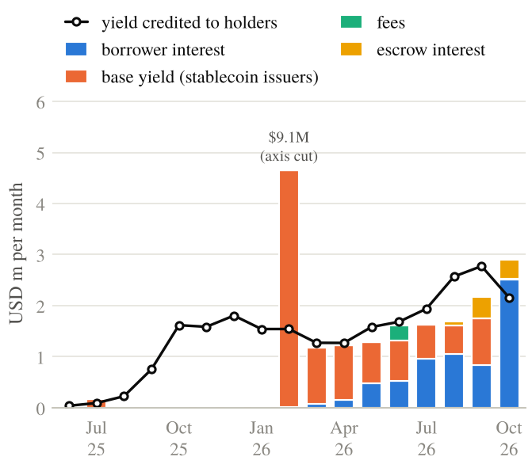

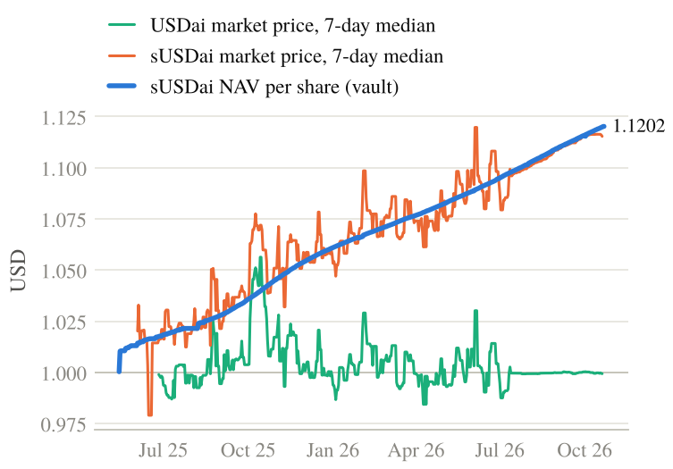

### 3. The vault's balance sheet, and $128.9M of escrow with no loan

We read the vault's accounting with `eth_call` at block <!--n:StateBlock-->517,316,432<!--/n-->, and the event scan ends at that same block, so both describe one moment. Our rebuilt loan book exceeds the vault's `pendingLoanBalance` by <!--n:LoanBookGap-->$0.39M<!--/n--> (<!--n:LoanBookGapPct-->0.22%<!--/n-->). Accrued interest is the likely explanation, but the contract does not expose the fields needed to itemize that residual, so it stays unresolved until each component is demonstrated. Event-derived shares plus our pending queue match `totalShares` to about 6e-8 shares, which is exact at any displayed precision; that identity checks share accounting, not cross-chain holder balances.

The same read shows that $128.9M, or 23% of reported assets, is escrow for two loans that no loan router has created. Both deposits were made on 2026-09-23, and together they equal `depositTimelockBalance` to the cent. The timelock contracts hold no tokens.

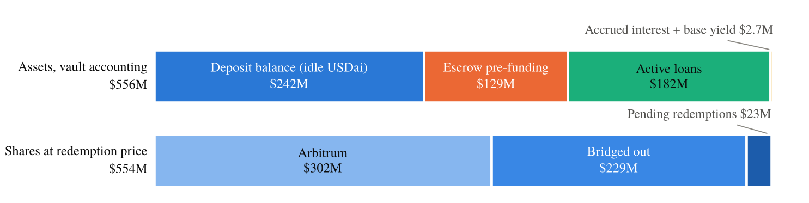

The USDai went from the vault to an escrow facility. That address is a Gnosis Safe, and its transactions are submitted by the same accounts that run the protocol's own multisig. The Safe redeemed the USDai to PYUSD the same day and sent it through one wallet to a busy off-ramp wallet that is active on 19 chains. The contracts allow this, and there may be a signed facility behind it that hasn't been posted on-chain yet. Holders are still earning yield on a claim whose funds have left the protocol's contracts. We label wallets only by their on-chain role and make no claim of misuse.

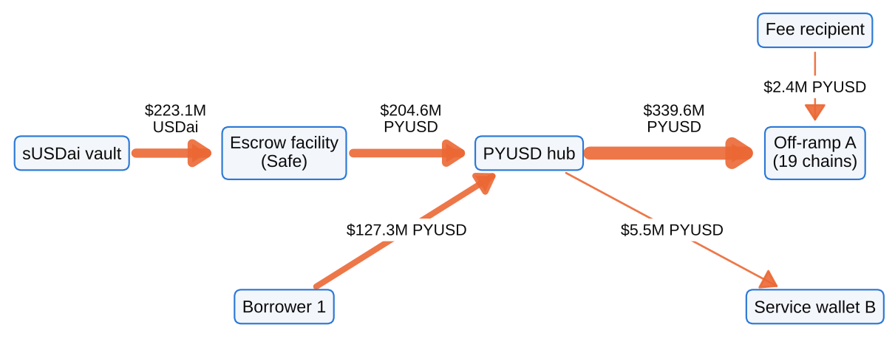

### 4. Holders and chains

sUSDai is on five chains. A few contracts and pools hold most of the supply on every one of them. On Arbitrum the ten largest holder addresses own <!--n:ArbTopTen-->86.7%<!--/n-->, and Pendle alone holds <!--n:PendleArb-->13.2%<!--/n-->. On Plasma, <!--n:PendlePlasmaUSDai-->44.1%<!--/n--> of USDai sits in Pendle and <!--n:VaultPlasmaUSDai-->20.0%<!--/n--> in vault strategies. Ethereum went from almost nothing in June 2026 to <!--n:EthSupplyLast-->89.3M<!--/n--> shares by October, and two addresses hold <!--n:EthTopTwo-->99.7%<!--/n--> of that, one of them Morpho Blue. Address concentration is not owner concentration: pools and bridges stand for many users.

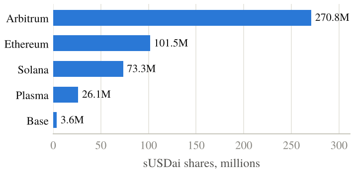

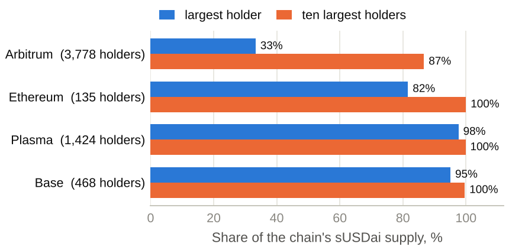

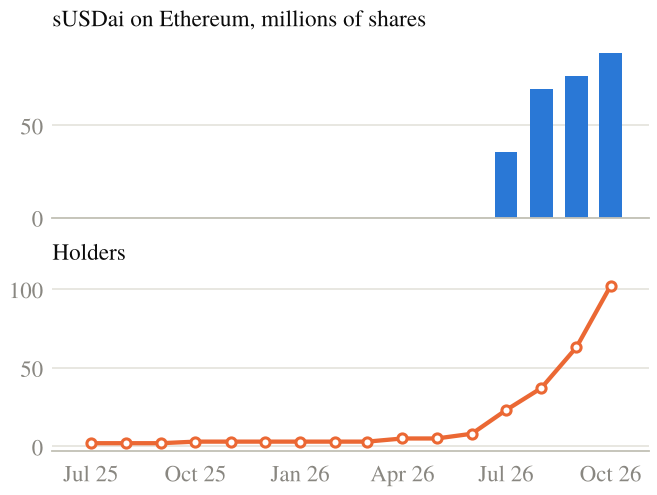

GoldRush's cross-chain activity endpoint lists every chain an address has used. The borrowers used between 4 and 12 chains each.

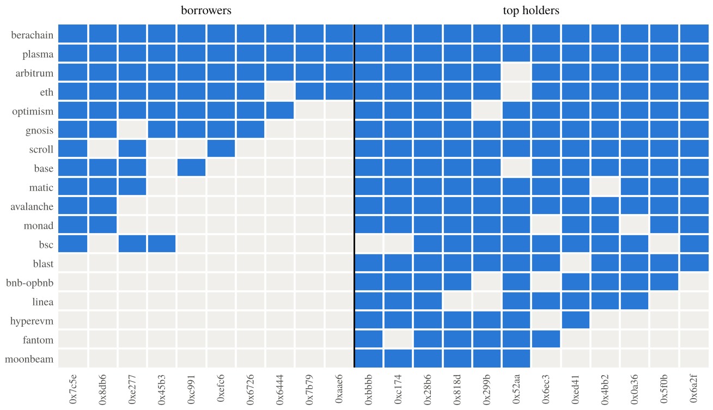

### 5. Exits

Holders filed <!--n:NRedeemRequests-->3,002<!--/n--> redemption requests. Among completed requests the median wait was <!--n:WaitMedian-->13.0<!--/n--> days, the 90th percentile <!--n:WaitPNinety-->26.6<!--/n--> days and the longest <!--n:WaitMax-->127.3<!--/n--> days; <!--n:PendingShares-->20.17M<!--/n--> shares were still pending at the cutoff, so their waits are censored. The queue is cleared in a few large monthly batches. Priced in PYUSD, USDai never traded below <!--n:USDaiRatioMin-->0.975<!--/n-->.

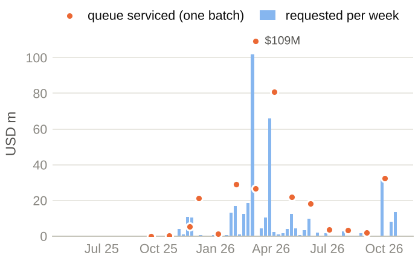

Redemptions do not move with GPU rental prices. The Spearman correlation on weekly changes is 0.01.

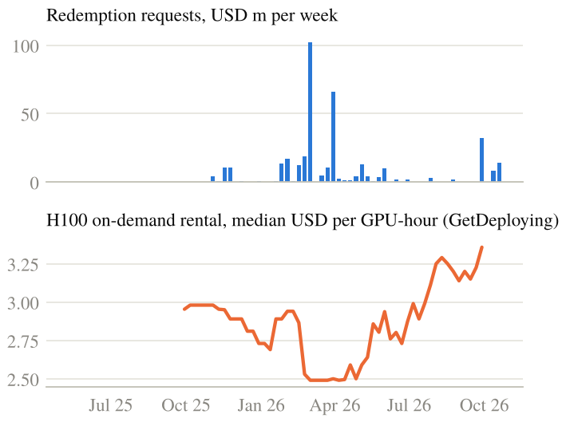

### 6. GPU credit vs. compute bought on-chain

Over the same period, Livepeer gateways paid orchestrators <!--n:LPUSD-->$1.01M<!--/n-->, and Akash users spent <!--n:AKUSD-->$3.47M<!--/n--> (from the Akash Console API). USD.AI's originations were <!--n:CreditMultiple-->65<!--/n--> times both combined. That compares capital advanced with operating payments made by different people; it is not a ratio of credit to compute demand. None of the GPU use these loans finance shows up on-chain.

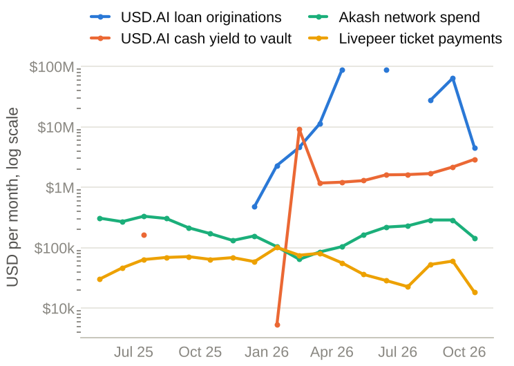

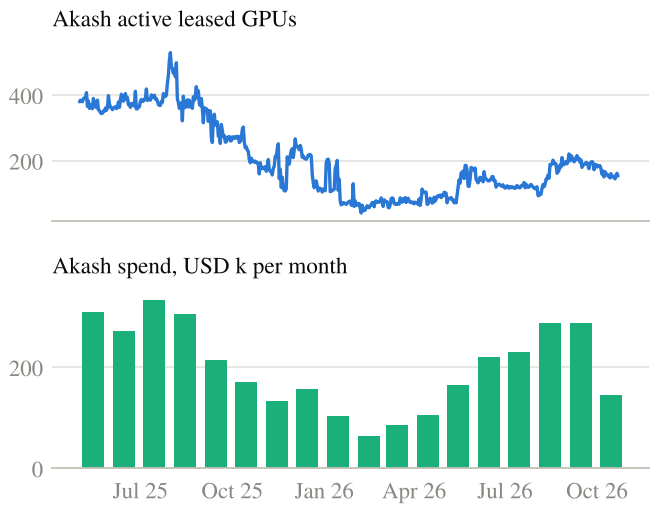

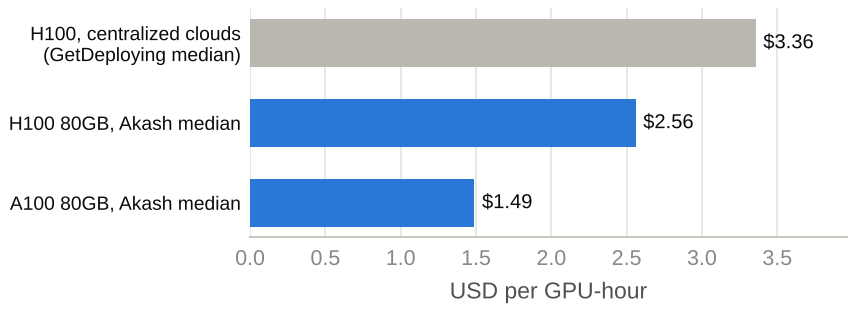

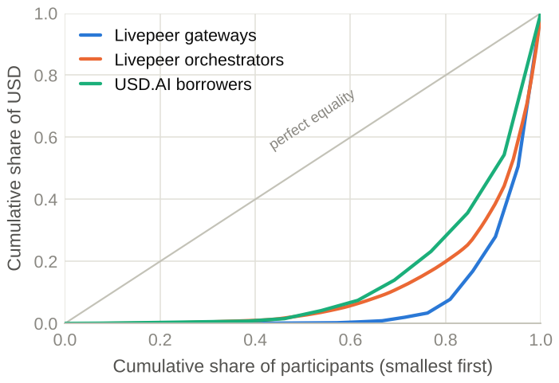

### 6b. What the debt implies about the compute

The chain doesn't show the GPUs, but it shows what they have to earn. Interest plus straight-line amortization on the active loans comes to $89.9M a year. At the Akash H100 price of $2.56 an hour, borrowers must sell 35.1M GPU-hours a year to service that from rental income alone: 5,724 H100s running at 70% utilization, drawing about 8.6 MW before cooling. At $1.50 it's 9,769 GPUs and 14.7 MW. The whole Akash network has 390 GPUs. This is a floor, since it ignores the borrowers' own costs. The pledged fleet is about 4,560 GPUs, so at 70% utilization it covers debt service at $3.21 per GPU-hour, and at full utilization at $2.25. B200 and B300 parts rent above H100 rates today, so the fleet can carry the debt if it's rented. What the protocol doesn't publish is utilization, revenue, location or power contract.

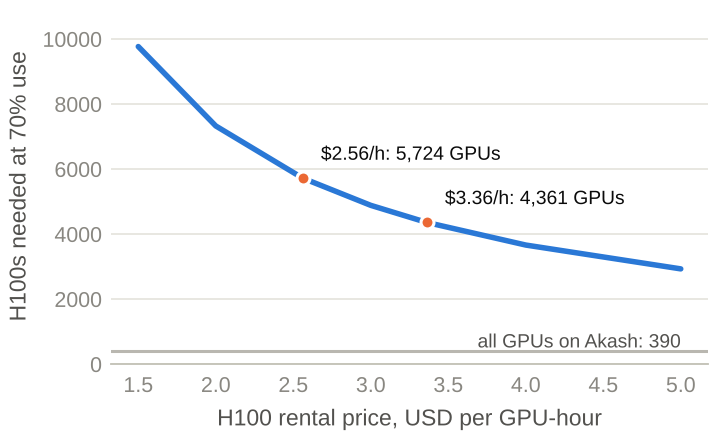

The framing comes from [Liquid Labor](https://liquid-labor.com), which measures machine labor in hours of work rather than units of hardware, and from the [GPU depreciation paper](https://github.com/uwecerron/GPU_Depreciation_Research).

### 7. What a neocloud unwind would do

The borrowers are GPU operators, the sector that now carries more than $20B of GPU-backed debt and where CoreWeave's credit default swaps hit distressed levels in October 2026. USD.AI is a small on-chain slice of the same trade. Using the reconciled vault state, a default by the largest borrower (29.9% of outstanding principal) at a 40% recovery on the GPUs costs 5.9% of assets and leaves NAV at 1.054. The three largest borrowers (70.5%) take it to 0.965, below par. Every borrower takes it to 0.900, and if the open escrow is not returned either, to 0.640. These are arithmetic, not a credit model.

Three design features decide how that would play out. Nothing marks a loan down before a breach event, so holders who watch the queue could exit at par first. Exits are a queue, and today idle cash covers it 11 times over, but after the idle cash is gone the vault waits on 2.6 years of maturities. And sUSDai is collateral in Morpho and Pendle, so a NAV mark would trigger liquidations into thin pools. Every GPU-backed dollar shares these mechanics, the same borrowers' customers and the same used-GPU market, so an unwind would hit them together. The code here measures the three things that separate survivors: borrower-only cash yield, borrower concentration, and idle cash against the queue.

### 8. Risks the chain shows only in outline

- **Related parties.** The same accounts submit the protocol multisig and the escrow Safe. The largest borrower, the fee recipient and the escrow all route to one off-ramp wallet. Fine on its face, but "13 independent borrowers" needs an entity map the chain doesn't give.
- **Key compromise.** Admin roles and the escrow Safe sit with a few signer accounts. The [Railway incident](https://github.com/uwecerron/railway_blockchain_incident) this week showed what one leaked key does: 231 wallets, 22 chains, about seven hours.
- **Fixed loans, floating benchmark.** Loans are fixed at 7% to 15% for 2.6 more years while the yield holders compare against moves.
- **Custody, title and valuation.** The hardware is described on-chain down to model and serial number, but not who holds it, where, under what filing or insurance, or whether the stated values are appraisals. At 67% LTV on a three-year life, there's little room for error.
- **Bridged exits.** 41% of shares are on other chains and must bridge back before they can queue.
- **Leverage on top.** Pendle holds 13% of Arbitrum sUSDai and Morpho 18% of Ethereum sUSDai. A NAV mark hits those positions first.
- **Classification.** Pooled private credit with a yield token. US payment-stablecoin rules now separate tokens that pay yield from those that don't, and this structure's treatment isn't settled.

### 9. Who this is for

- **Traders:** three signals lead a NAV mark, and the code polls all three: a missed monthly repayment, the queue rising against idle cash (11x covered today), and the DEX discount to NAV.
- **Allocators:** underwrite the $128.9M escrow first, price yield on borrower cash alone (28.5% coverage), treat the book as one neocloud exposure with 30% in a single name at 67% LTV, and ask who appraised the stated collateral values and what the fleet's utilization is.
- **Neoclouds:** USD.AI already publishes model, count and stated value for every pledge. A borrower that added utilization, revenue and a power contract would be the first a lender could underwrite from public data, and could ask for less than the 10.26% weighted rate.
- **Researchers:** frozen dataset, offline reproduction, method that transfers to any GPU-credit protocol. Open questions are collateral counts, borrower revenue and recoveries after the first default.

## Where the data comes from, and how we checked it

| Data | Source |
|---|---|
| Event logs, transaction histories, holder lists (current and at past blocks), prices, cross-chain activity, wallet balances | Covalent GoldRush API |
| Vault accounting at one block (`totalAssets`, `depositTimelockBalance` and the rest) | `eth_call` on a public Arbitrum node |
| Hardware-token `tokenURI` and `ownerOf` for every pledged token | `eth_call` on a public Arbitrum node |
| Collateral records (model, units, stated value, useful life) | USD.AI's metadata host, linked from the token |
| Solana token supply | public Solana node |
| Akash spend, GPUs, providers, prices | Akash Console API |
| H100 rental prices | GetDeploying (CC BY 4.0) |

To be sure the GoldRush data is complete and correct, `python3 -m compute_forensics verify` pulls the same logs again from a public Arbitrum node with `eth_getLogs`, without GoldRush, and compares the two log by log (by transaction hash, topics and data) and by summed amounts. All 22 event sets match exactly: 246,176 logs covering every loan origination, repayment, migration, refinance, lender payout, fee, USDai mint and redemption, vault deposit, redemption request, escrow event and Livepeer ticket payment. It also compares token supply with the sum of holder balances and re-reads the escrow redemption receipt. Results are in `data/verification/onchain_checks.json` and in the verification table of the paper (Section IV).

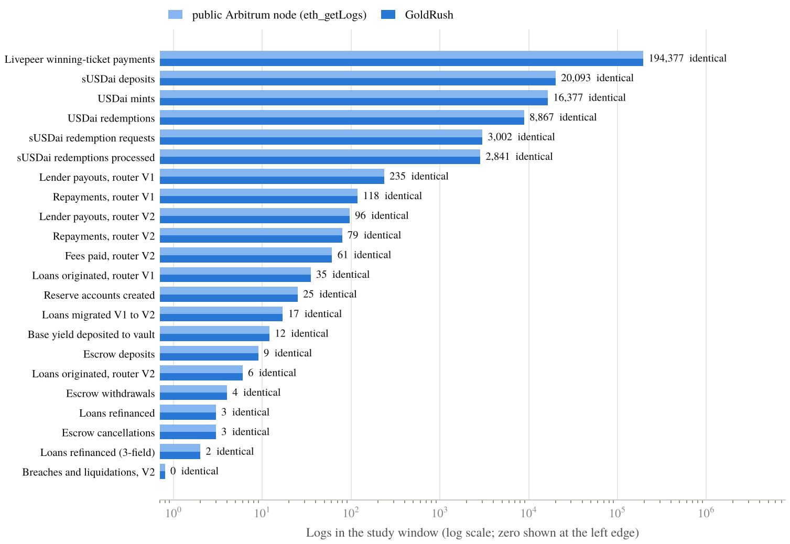

A second, independent pass is in [`data/verification/VALIDATION.md`](data/verification/VALIDATION.md): a validator with its own decoders (scripts in `data/verification/independent/`) recomputed every headline number from the frozen data, matched them within 0.5%, and re-read the escrow balance, collateral metadata and USDai reserves live from the chain.

The check caught one real problem, now fixed. GoldRush's event endpoint treats `ending-block` as exclusive, so the first scan skipped the last block of every 1,000,000-block window. That dropped one Livepeer ticket payment (0.0024 ETH) and nothing from USD.AI. The code now asks for `hi + 1`, and `collect --stage boundaries` patches older data. We also found that GoldRush sometimes numbers logs inside a transaction differently from the node, so the code never matches or deduplicates on log index.

The check also reads USDai's reserves: at the block of the check the USDai contract held about as much PYUSD as there was USDai in circulation across the hub and the EVM spokes (coverage 100.0%, Solana's few hundred tokens left out). That is one block and one scope, not a reserve audit, and it says nothing about redemption capacity under stress.

Prices, Akash figures and GetDeploying data are not on Arbitrum, so this check does not cover them.

## Research ledger

[`RESEARCH.md`](RESEARCH.md) traces every headline number to its result field, method and independent check, lists every data file and external source, and states what is assumed rather than measured.

## What is in here

```
compute_forensics/   the pipeline (collect, decode, stitch, analyze, figures, paper macros)
data/frozen/         canonical gzipped API responses + MANIFEST.sha256
data/external/       GetDeploying weekly GPU prices (CC BY 4.0), unmodified
results/             results.json, loans.csv, borrowers.csv, monthly_yield.csv, nav_daily.csv
paper/               IEEE LaTeX source, generated numbers/tables, figures, main.pdf
visuals/index.html   the whole study as one offline page
tests/               40 offline unit tests, including key-leak tests
data/verification/   the GoldRush-vs-chain check results
```

How it works:

1. **Decode from source.** Every event signature comes from USD.AI's public contracts, including the full git history, so renamed and removed events still decode. A log is accepted only when its topic count matches the signature's indexed parameters.
2. **Stitch the loans.** Migrations and refinancings change a loan's terms hash. We follow each chain of hashes back to the original loan, map reserve accounts back to borrowers, and keep each hash in its own currency and decimals.
3. **Check against state.** Every total we compute from events is compared with the vault's own views (`totalAssets`, `totalShares`, `bridgedSupply`, `depositTimelockBalance`, `loanRouterBalances`) at a single block.
4. **Follow the cash.** Escrowed funds are traced through decoded stablecoin transfers, up to two hops, stopping at service wallets.

## Charts

All charts use one colorblind-checked palette (blue, orange, aqua, yellow, with gray for "other"), one y-axis per panel, hairline grids and direct labels. They are generated by `compute_forensics/figures.py` as PDF for the paper and PNG for this README.

## Reproduce it

You do not need an API key to reproduce the paper. Everything runs offline from `data/frozen`, and the manifest is checked first.

```bash
python3 -m pip install -r requirements.txt
python3 reproduce.py             # numbers, tables, figures, visuals/index.html
python3 reproduce.py --compile   # also builds paper/main.pdf (needs pdflatex + bibtex)
make test                        # 41 tests
```

Tested on Python 3.13. Dependencies are pinned in `requirements.txt`.

To pull fresh data, you need a GoldRush key:

```bash
cp .env.example .env             # then put GOLDRUSH_API_KEY=... in .env
python3 -m compute_forensics collect --stage all   # includes the collateral stage
python3 -m compute_forensics freeze
python3 reproduce.py --compile
```

A full collection makes a few thousand API calls and takes about an hour, mostly the Livepeer scan and wallet histories. Responses are cached in `data/cache/`, so reruns are fast.

## Getting a GoldRush API key

- Sign up and create a key: https://goldrush.dev/platform/auth/register/
- Plans and billing: https://goldrush.dev/platform/billing/
- Higher limits, enterprise access or questions: sales@goldrush.dev, or the GoldRush support channels and Discord linked from https://goldrush.dev

Never paste your key into an issue, a notebook you plan to share, or a commit.

## Security tips

- Keep the key in `.env` or in the `GOLDRUSH_API_KEY` environment variable. `.env` is git-ignored.
- The code wraps the key in a `Secret` type that refuses to print, format or pickle itself, and it redacts the key from every error message. Do not work around that.
- Run `python3 -m compute_forensics scan-secrets` before you push. CI runs it too, and `scripts/pre-commit` can run it on every commit: `ln -s ../../scripts/pre-commit .git/hooks/pre-commit`.
- The cache only stores request paths, parameters and responses, never the key. Still, do not commit `data/cache/`.
- If a key leaks, rotate it in the GoldRush dashboard right away. Deleting it from git history is not enough, because forks and clones keep it.
- Use a separate key with tight limits for CI or shared machines.
- Treat anything you download from a chain or an API as data, not code.
- Report a vulnerability privately to the repo owner, not in a public issue. See `SECURITY.md`.

## Scope and limits

- The chain can verify liabilities and cash. It cannot verify that a GPU exists, that it is rented, or that a borrower can pay.
- We reconcile against vault state at one block (the same block the event scan ends at), not continuously. The $0.39M loan-book residual is unexplained until each component of it is demonstrated. Holder snapshots are at a nearby block and the USDai reserve read at a later one.
- Two topic hashes on the V1 loan router do not match any signature in the source history. We count them and leave them out.
- Holder snapshots are current. Historical holder snapshots are only available on GoldRush Foundational chains, so we have them for Ethereum, not Arbitrum.
- GoldRush has no `eth_call` and does not index Akash, so vault state comes from the public Arbitrum RPC, Solana supply from the public Solana RPC, and Akash numbers from the Akash Console API. Each is labeled where used.
- Livepeer payments mix transcoding and AI inference. The events do not separate them.
- Wallets are described only by on-chain role. Press coverage names some borrowers. One reported $26.82M facility matches a single on-chain loan of $26,821,644. We do not attribute addresses to companies in the results.

## Right of reply

We invite corrections and an explanation of the escrow accounting from USD.AI, and will incorporate any substantiated response in a revised version. The finding describes contract state and token transfers; it does not claim misuse of funds.

## AI disclosure

AI assistants (Claude and ChatGPT) helped with the code, the drafting and editorial consistency checks. Every number in the paper, README and visuals is generated by the code from the frozen data, and the method and results were reviewed by the author.

## Data and attribution

- Chain data: Covalent GoldRush API.
- GPU rental prices: GetDeploying, CC BY 4.0. The file is the same one used in [GPU Depreciation Research](https://github.com/uwecerron/GPU_Depreciation_Research), and its SHA-256 matches.
- Akash: Akash Console API (public).
- Arbitrum and Solana public RPC endpoints.
- USD.AI contract source: public repositories.

## License

Three different things live in this repository, under three different terms:

- **Code** (`compute_forensics/`, `scripts/`, `tests/`, `reproduce.py`): MIT, see [`LICENSE`](LICENSE).
- **Paper** (`paper/sections`, `paper/main.tex`, the PDFs): copyright Uwe Jens Cerron, all rights reserved, see [`paper/LICENSE`](paper/LICENSE). Cite and link freely; ask before reproducing text or figures beyond fair use.
- **Data**: each source keeps its own terms. GetDeploying prices are CC BY 4.0; GoldRush responses are subject to Covalent's terms; Akash Console API, public RPC data and the USD.AI metadata records are used as published by their operators. The frozen files are provided so the paper can be reproduced, not as a redistributable dataset.
